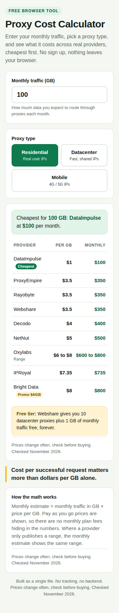
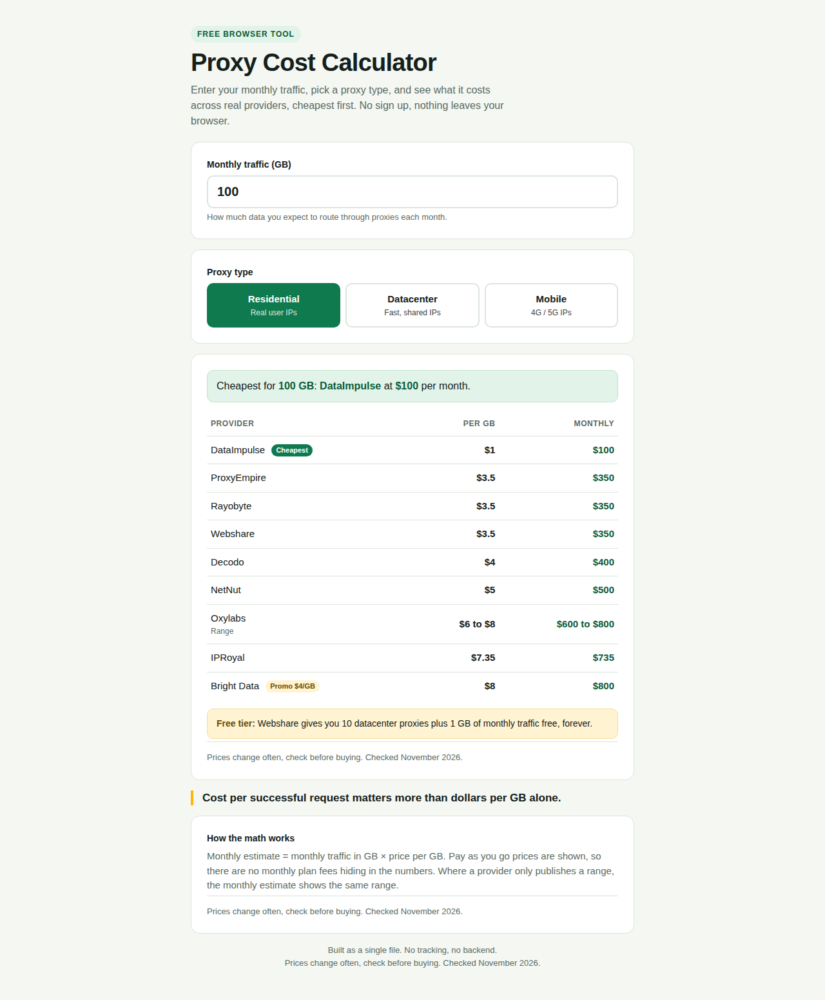

<div align="center">

# proxy-cost-calculator

**Work out what proxies really cost you per month, before you buy.**

Enter your monthly traffic in GB, pick a proxy type, and compare real per GB prices across providers, cheapest first. One file, no signup, nothing leaves your browser.

[](https://github.com/smabdulmueid97/proxy-cost-calculator/blob/main/LICENSE)
[](https://github.com/smabdulmueid97/proxy-cost-calculator/stargazers)
[](https://github.com/smabdulmueid97/proxy-cost-calculator/commits/main)

**[▶ Try it in 10 seconds — live demo](https://smabdulmueid97.github.io/proxy-cost-calculator/)**

No signup. No backend. No tracking.

</div>

---

## Screenshots

| Mobile | Desktop |
|---|---|
|  |  |

> Tested at 360 / 768 / 1280 px — no horizontal overflow, no clipped buttons.

## What it does

- Enter monthly traffic in GB and see a monthly cost estimate per provider, cheapest first
- Compare three proxy types: residential, datacenter, and mobile
- Shows per GB prices and the monthly estimate side by side, so the cheapest option is obvious at a glance
- Flags the Webshare free tier: 10 datacenter proxies plus 1 GB of monthly traffic free, forever
- Runs entirely in your browser as a single HTML file, no build step, no server, no data sent anywhere

## Why this exists

Proxy pricing is quoted per GB, which makes it hard to feel what a month actually costs. A provider at $3.50 per GB sounds cheap until you run 500 GB through it. This calculator turns the per GB number into a monthly dollar figure across the providers people actually compare, so you can budget before you buy.

## Quick start

Open `index.html` in any browser, or serve the folder:

```bash
git clone https://github.com/smabdulmueid97/proxy-cost-calculator.git
cd proxy-cost-calculator
python3 -m http.server 8000
```

Then open http://localhost:8000 in your browser.

## How to use

1. Type your expected monthly traffic in GB (100 GB is prefilled as a starting point).
2. Pick a proxy type: Residential, Datacenter, or Mobile.
3. Read the table: providers are sorted cheapest first, with the cheapest row highlighted.
4. For datacenter, only a typical range is shown, because no provider datacenter per GB price was verified. For mobile, only Bright Data has a verified per GB price, other providers say "check provider site".

## Prices

Monthly estimate = monthly traffic in GB × price per GB. Pay as you go prices are shown.

| Provider | Type | Per GB |
|---|---|---|
| DataImpulse | Residential | $1 |
| ProxyEmpire | Residential | $3.50 |
| Rayobyte | Residential | $3.50 |
| Webshare | Residential | $3.50 |
| Decodo | Residential | $4 |
| NetNut | Residential | $5 |
| Oxylabs | Residential | $6 to $8 |
| IPRoyal | Residential | $7.35 |
| Bright Data | Residential | $8 (promo $4) |
| Typical range | Datacenter | $0.50 to $3 |
| Bright Data | Mobile | $8.40 |

> Prices change often, check before buying. Checked November 2026.

Cost per successful request matters more than dollars per GB alone. A cheaper per GB price can still cost more if more requests fail or get blocked.

## License

MIT — use it, sell with it, no attribution required.
